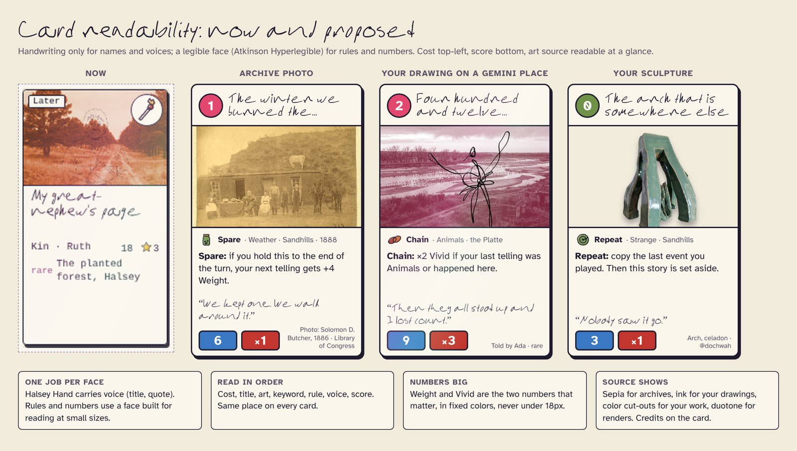

# Halsey, Nebraska: the deck builder

A proposal. The game becomes a roguelike deck builder about trading stories. Your deck is your testimony. You spend **trust** to tell stories, you win **credibility**, and you trade stories with the people you meet.

## What the big ones teach

| Game | What it does well | What Halsey takes |
|---|---|---|
| **Slay the Spire** | A branching map of fights, events, shops and rests. A small energy budget each turn. Enemies show their intent before they act. The best decks are small: removing cards is power. | The map and node types. Trust as energy. Tellers show what they're about to do. Giving stories away thins your deck. |
| **Balatro** | Score = chips × mult, against a rising target. Jokers change the rules and fire left to right. Every deck is a different game, not a stronger one. | Credibility = Weight × Vivid against each teller's threshold. Keepsakes (barn quilts) fire in order. Starting towns are different games. |
| **Griftlands** | Negotiation as a fight. Your resolve carries between negotiations. Arguments sit in the conversation and can be targeted. | A teller's **reservations** sit on the table and can be answered. Your **standing** carries across the run. |
| **Signs of the Sojourner** | Conversations are matching games. After each one you swap a card for one your partner used, so your deck becomes the people you've met. Regions speak in their own symbols. | The trade: after a sitting you give a story and take one of theirs. Places have their own tags (rivers, Sandhills, towns), so your deck drifts toward where you've been. |
| **Where the Water Tastes Like Wine** | Telling stories to strangers who want a certain kind of tale. Stories change as they pass between people. Critics said the stories turned into mere currency, and the changes happened off screen. | Wants. Stories come back retold, and we show the changed card on screen. Keep stories as more than currency: every card is a person's words, with their face on it. |
| **Inscryption** | Costs that hurt (sacrifice). A strange, physical table. | Risk stories cost credibility, not just trust. The table is paper, ink and photographs. |
| **Dominion** | The market: you choose what enters your deck. | The courthouse and the road act as the market. |

Sources: [GameSkinny on Griftlands negotiation](https://www.gameskinny.com/tips/griftlands-what-are-negotiations-and-how-do-they-work/), [VICE on Signs of the Sojourner](https://www.vice.com/en/article/how-signs-of-the-sojourner-tries-to-rethink-the-video-game-dialogue-tree), [GDC narrative review of Sojourner](https://media.gdcvault.com/gdc2026/GNR/Papers/Katherine+Jordan+-+Signs+of+the+Sojourner+Narrative+Review.pdf), [Slay the Spire design tensions](https://saschb2b.github.io/game-mechanics/games/slay-the-spire/design-tensions), [subtractive deckbuilding](https://saschb2b.github.io/game-mechanics/concepts/subtractive-deckbuilding), [Balatro scoring analysis](https://saschb2b.github.io/game-mechanics/games/balatro/poker-scoring), [Balatro lessons](https://saschb2b.github.io/game-mechanics/games/balatro/lessons), [A.V. Club on Where the Water Tastes Like Wine](https://www.avclub.com/where-the-water-tastes-like-wine), [Game Developer on designing for deck-building](https://gamasutra.com/design/designing-for-deck-building-in-video-games).

## Two words

- **Trust** is what you spend. Each turn of a sitting you have a few points of trust (start at 3). Telling a story costs trust. Small talk is free; the hard stories cost more. The teller refills it each turn, and opens up (more trust per turn) as you earn credibility with them.
- **Credibility** is what you win. Each sitting has a credibility threshold, like a Balatro blind. Reach it before dark and the teller trades with you. Across the run you also carry **standing**: your credibility with the Survey itself. It works like health. Stories that ring false, contradictions and tellers who walk away cost standing. At zero, your testimony is struck and the run ends.

## A sitting (the core fight)

1. **The teller sits down.** Their portrait is your drawing of them. Their **want** (a theme) and **reservations** are on the table. Their **intent** for this turn is shown, as in Slay the Spire: *Doubt 4* (they'll knock 4 credibility off unless you answer it), *Asks about Halsey* (a bonus for a story from there), *Tells one of their own*, *Goes quiet*.
2. **You draw five stories** and have your trust for the turn.
3. **You tell.** Each telling is one to three stories played together. Credibility gained = **Weight × Vivid**:
   - Weight is the sum of the cards' weights.
   - Vivid starts at the highest card's vivid and grows with **links**: stories sharing a theme (Witnesses), a place (Ground), an era (Kept), or a person (Thread). A three-card telling that shares all of them is a Whole Story.
   - Events fire: **Chain** (more if it continues the last telling), **Find** (draw, or look at the top three), **Risk** (big weight, costs standing if trust is low), **Spare** (held to the end of the turn, it boosts the next telling), **Repeat** (copies the last event).
   - Keepsakes (barn quilts) fire left to right.
4. **Reservations.** A reservation such as *“Surveyors take and don’t give”* halves your Vivid until you answer it, by telling a story that matches its tag, or a story of your own.
5. **Dark.** You have a set number of turns (daylight). Reach the threshold and the teller **trades**. Miss it and you lose standing and leave with nothing.

### The trade (the heart of it)

When a sitting succeeds, you **give one story and take one**. You take a card you saw the teller tell, as in Sojourner. You give one of yours, which removes it from your deck, as in Slay the Spire, and it goes out into the world.

- Your deck becomes the people you met, and giving is how you get better.
- Stories you gave away **come back retold** later, at another teller's table: same title, higher vivid, a detail changed, and a new face in the corner. The game shows the change.
- Consent is mechanical: nobody gives you a story unless you give one back.

## The run (the map)

A branching map from your starting town to the Missouri, about 12 legs, like Slay the Spire's acts. Node types:

- **Sitting:** a teller (the core fight).
- **Holdout:** an elite sitting. Higher threshold and reservations that never clear. The reward is rare, and a holdout's stories can't be filed.
- **On the road:** a written event with choices (what exists now).
- **Arch:** rest. Retell a story to upgrade it (+vivid), or recover standing.
- **Courthouse:** the Register of Deeds. File stories into the record: they leave your deck for good and become **record**, the run's score. You can also buy a keepsake. Filing is the second way to thin your deck, and the tension is real: file your best story now for record, or keep it to win sittings.
- **Era pocket:** a strange node with special rules (the 1888 pocket only accepts stories kept at 1888).
- **The bridge:** the final hearing at the Missouri. Your record and standing decide which endings are open: sign, refuse and stay, or take the water.

**Modes that feel different.** A sitting is the card fight. The road is reading and choosing. The courthouse is a puzzle of what to keep and what to file. The sandbar count is a spatial estimating game whose results become cards.

## Cards from everything

Every card is a story, and its art says where the story comes from. The source sets the treatment, so a player learns to read a card's origin at a glance:

| Source | Treatment | Example |
|---|---|---|
| Your notebook drawings | Ink on paper, the drawing large | a crane, the critter, a portrait |
| Your Instagram work | Full color, the object cut out and set on paper | the arches, the paintings, the auroras |
| Gemini renders | Duotone in the event's ink | the places, the cast |
| Public archives | Sepia, a thin rule, the credit printed on the card | Solomon Butcher's Custer County, 1886 to 1912 (Library of Congress) |
| Code | Generated: barn quilts, flocks, the night print | keepsakes, effects |

Public images come in through `tools/fetch-public.py`. It keeps only items marked “No known restrictions” (or public domain) and records the title, date, maker, rights statement and link in `art/public/credits.json`. Each card that uses one prints its credit. People in archival photographs were real; cards that use them should treat them as witnesses, not as decoration.

## Builds

What a good deck looks like after an hour:
- **The long thread:** many people who know each other. Thread links stack Vivid.
- **The jar:** Spare stories held back for one enormous telling.
- **The match:** Risk stories that win fast and spend standing.
- **The ledger:** cheap stories, filed constantly for record. You win the run on paper, not at the table.
- **The ground:** everything from one place. Strong in that region, weak away from it.

## First prototype

One sitting, fully playable: 15 starting stories, three tellers with intents, wants and reservations, Weight × Vivid scoring with links, the trade at the end, and one story coming back retold. If that isn't fun, nothing else matters.

## Readability

- **One job per typeface.** Halsey Hand for voice only: names, titles, quotes. Rules, numbers and labels in a face built for small sizes (Atkinson Hyperlegible, made by the Braille Institute for low-vision readers; free on Google Fonts).
- **Fix the four confusable letters before using the hand for names.** In Halsey Hand, r reads as n, f as l, k as h, and capital R as K: Thedford reads “Thedlord,” Register “Kegister,” Broken “Brohen,” Missouri “Missouni.” Until the template is filled, swap in clearer variants from the notes for those letters, or set place names in the text face.
- **Short titles.** Titles of two lines at most, about 24 characters. The full line lives in the quote.
- **A fixed card anatomy.** Cost top-left, title, art, keyword line, one rule sentence, the teller's voice, then Weight and Vivid big at the bottom in fixed blue and red. The same place on every card.
- **Art source readable at a glance.** Sepia for archives, ink for your drawings, color cut-outs for your work, duotone for renders. Credits on the card.
- **Minimum sizes.** No running text under 13px, no number under 18px, and no gray lighter than the muted token on the card color.
- **A quieter scene.** The section grid, registration marks, stamps, scraps, flocks and moths all compete with the photograph and the drawings. Default to a quiet layer set; show marks only when they mean something (a stamp where you just told a story).
- **Feedback where the action is.** Show “+12 credibility” rising from where you told the story, Balatro-style, rather than in a log paragraph under the portrait.
- **The route as a map, not 18 buttons.** A drawn line from Halsey to the Missouri with dots for places, the current one marked.
- **Rules on demand.** Replace the legend block with tooltips on icons and keywords.

## Decided (Nov 23)

- **Standing is health.** It carries across the run. An unanswered doubt costs 1, a risky story told before they're warm costs 1, a failed sitting costs 3. At 0 your testimony is struck.
- **You're ranked at the end by total score:** all the credibility you earned, plus standing × 15. Ranks: Noted, Entered (600), Recorded (850), Indexed (1050), Bound into the record (1250). Working names.

## First playable: `prototypes/sitting/`

Three sittings (Ruth at Halsey, Tomás on the North Loup, Odette at the Register of Deeds), a 12-story starting deck, trust 3 a day (4 once they're warm), four days a sitting, the trade after each win, an arch between sittings (rest or retell), and the final rank. Rules live in `game.js` with no drawing code, so `tools/playtest/sitting-bot.js` can play them: with thresholds of 140, 240 and 340, a brute-force bot wins about 100%, 99% and 94% of the three sittings, and its final scores spread across Recorded, Indexed and Bound into the record. People play worse than the bot, so this should feel fair. Tune from real play.

## The full run (v2)

- **The map:** eight rows from Halsey (Ruth, always first) to the bridge over the Missouri (Imani, always last). Each row between has two or three stops: sittings, the road, arches, courthouses, and one holdout per run (Frank at the Dismal). No two of the same stop sit side by side. Tellers appear where they live: Priya and Deshawn early, Walt and Tomás in the middle, Ada, Gus, Marisol, Arne and Odette late.
- **Thresholds rise with distance:** 120 at Halsey, about +44 a row, holdouts ×1.25, the bridge 350.
- **Keepsakes:** ten barn quilts drawn by code, each a rule change (Sawtooth, Ohio Star, Log Cabin, Flying Geese, Pinwheel, Bear's Paw, Lone Star, Churn Dash, Dresden Plate, Drunkard's Path). One from each courthouse, one for beating the holdout, sometimes one from the road.
- **Courthouses:** file up to two stories for Weight × Vivid × 6 to your score. They leave your deck for good; you keep at least 8, and unsigned (holdout) stories can't be filed.
- **The road:** six written encounters with two choices each (standing, a new story, a retelling, a keepsake).
- **The bridge:** Imani opens by telling one of her own Leaving stories, so you can answer her reservation with her own words. Win or lose, you choose an ending: sign, refuse and stay, or take the water.
- **Score:** credibility + filing + standing × 20. Ranks: Noted, Entered 1300, Recorded 1900, Indexed 2400, Bound into the record 2800.
- **Bot balance:** early sittings ~100%, middle ~92%, late ~80%, the holdout ~90%, the bridge ~49%. About 1 run in 8 ends struck. Median final score ~2100 (Recorded).
